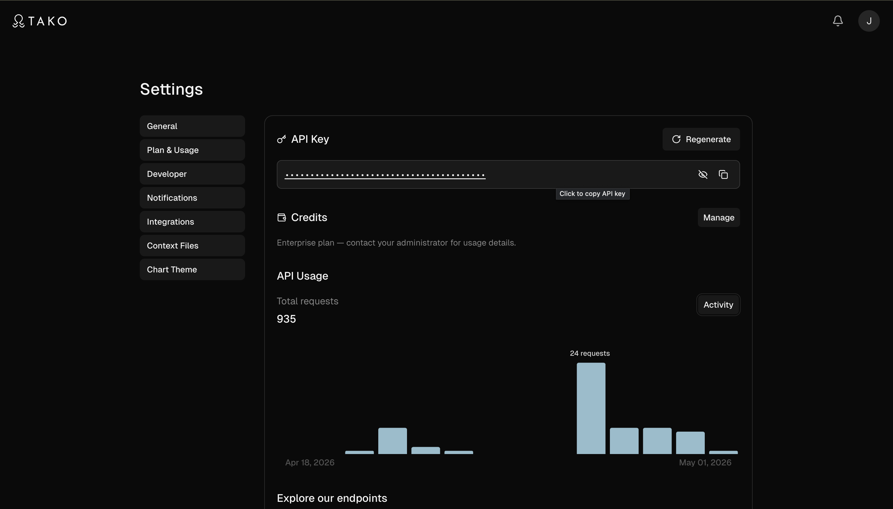
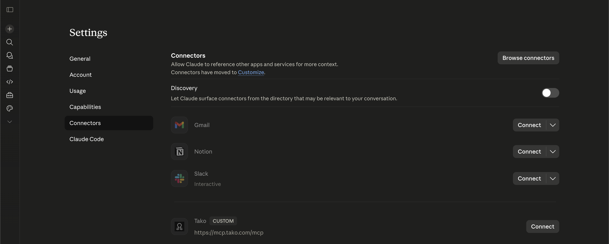
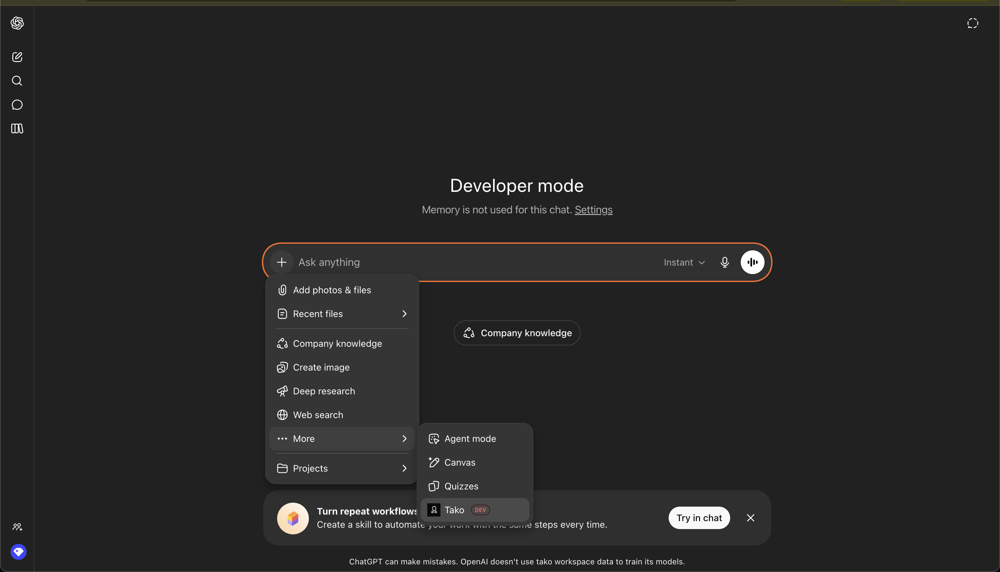
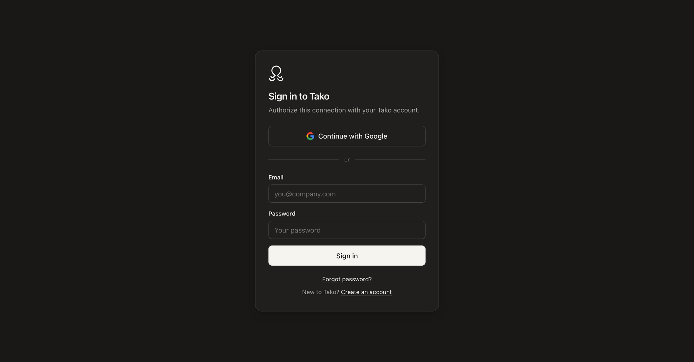
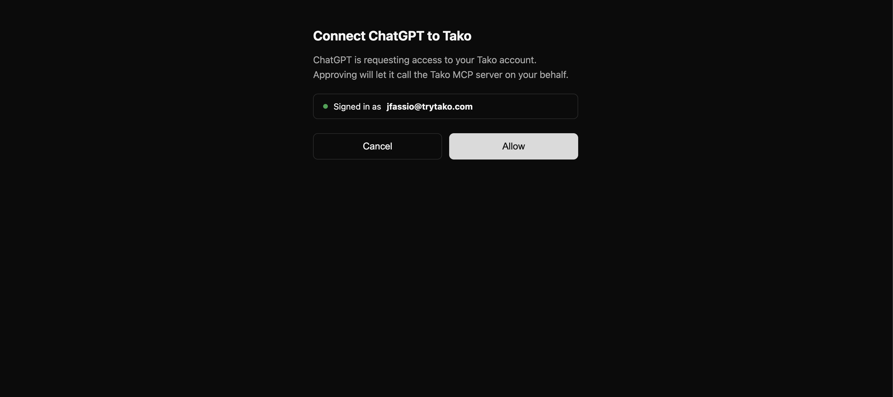

# Tako MCP Server

[](https://docs.tako.com/documentation/integrations/mcp-server)
[](https://registry.modelcontextprotocol.io)
[](https://smithery.ai/servers/tako/tako)
[](https://lobehub.com/mcp/takodata-tako-mcp)
[](LICENSE)
[](https://tako.com/blog/evaluating-a-new-kind-of-search-api/)

Tako MCP gives your agent industry-leading live web search plus licensed data that the open web does not have. That includes company financials, macroeconomic indicators, website traffic, sports, US government spending, and more.

**[Full Documentation](https://docs.tako.com/documentation/integrations/mcp-server)** · **[Get your API key](https://tako.com/console/api-keys)** · **[MCP Registry](https://registry.modelcontextprotocol.io)**

Tako MCP lets an agent:

- **Search** Tako's knowledge graph and the live web — every card renders as a chart on the ChatGPT app (the first card's chart elsewhere), and `tako_contents` reads the rows behind it
- **Discover** exactly what proprietary data exists for an entity or metric
- **Fetch** the underlying rows (JSON) or a page's text behind any result URL
- **Visualize** your own structured data as an embeddable card — public and permanent, readable by anyone with the link _(opt-in; on by default on the ChatGPT app)_
- **Run** Tako's Answer Agent for deep, multi-step research, or its Company Agent for company and registry-officer questions _(opt-in; on by default on the ChatGPT app)_

> **Why a data-native search API?** On Tako's [VerticalRTK benchmark](https://tako.com/blog/evaluating-a-new-kind-of-search-api/) of real-time domain questions (finance, economics, sports, weather), Tako outperforms the next-best web search API by **21%** — while using **~75% fewer tool calls at up to one-tenth the cost**, and answering research tasks in **15.5s vs 124.2s** for OpenAI web search. It reaches parity with Exa, Parallel, Nimble, and Tavily on standard web benchmarks (SimpleQA, FRAMES) and pulls ahead where structured, real-time data matters. **[Read the evals →](https://tako.com/blog/evaluating-a-new-kind-of-search-api/)**

## Installation

Point your MCP client at the hosted endpoint — no install, no local server, no token:

```
https://mcp.tako.com/mcp
```

Paste the URL. Sign in when your client prompts you — a per-host key is minted automatically, and new accounts get up to 2,000 free requests. Until you sign in, the connection runs anonymously: `tako_search` works right away (rate-limited), and every other tool — listed like everything else — asks you to sign in when called. For CI, headless use, or a client without an OAuth flow, connect with an API key instead — see [API keys and headless clients](#api-keys-and-headless-clients).

### One-click install

[](https://cursor.com/install-mcp?name=tako&config=eyJ1cmwiOiJodHRwczovL21jcC50YWtvLmNvbS9tY3AifQ==)
[](https://insiders.vscode.dev/redirect/mcp/install?name=tako&config=%7B%22type%22%3A%22http%22%2C%22url%22%3A%22https%3A%2F%2Fmcp.tako.com%2Fmcp%22%7D)
[](https://insiders.vscode.dev/redirect/mcp/install?name=tako&config=%7B%22type%22%3A%22http%22%2C%22url%22%3A%22https%3A%2F%2Fmcp.tako.com%2Fmcp%22%7D&quality=insiders)

Claude Code installs with one command — the plugin brings the MCP connection plus Tako's bundled [lookup and research skills](#agent-skills):

```bash
claude plugin marketplace add TakoData/tako-mcp && claude plugin install tako@tako
```

Gemini CLI installs as an extension. Same one command, same bundled skills, plus `/data`, `/chart`, and `/coverage` commands:

```bash
gemini extensions install https://github.com/TakoData/tako-mcp
```

Each of these lands on the free tier immediately. Authenticate later to unlock the full toolset — see your client's section below.

Pick your client below.

<details>
<summary><b>Claude Code</b></summary>

**Plugin (recommended)** — installs the MCP connection plus Tako's bundled [lookup and research skills](#agent-skills) in one step, and works immediately on the free tier — no API key to mint or manage:

```bash
claude plugin marketplace add TakoData/tako-mcp
claude plugin install tako@tako
```

That's it — `tako_search` works right away on the anonymous free tier. To unlock the full toolset and your own account limits, authenticate once with OAuth: run `/mcp` inside Claude Code, select **tako**, and choose **Authenticate**. A browser opens to sign you in with your Tako account and a per-host API key is minted for you automatically (visible and revocable at [tako.com/console/api-keys](https://tako.com/console/api-keys)). The same OAuth flow powers the plugin on Claude.ai — the plugin's Tako connector connects with a click, no token pasting.

If you previously added the server with `claude mcp add`, remove it first (`claude mcp remove tako-mcp`) so you don't end up with two copies of every tool.

> **Updating from an earlier plugin version?** Older releases asked for a Tako API key in the plugin config; that setting is gone, so after updating your connection silently lands on the anonymous tier (`tako_search` runs; the rest asks you to sign in) — nothing errors, but your account limits are no longer active. Run `/mcp` → **tako** → **Authenticate** once (or use the Connect button on Claude.ai) to restore full authenticated access.

**Or add the MCP server directly** (then authenticate in place via `/mcp` → **tako** → **Authenticate**):

```bash
claude mcp add tako --transport http https://mcp.tako.com/mcp
```

Verify with `claude mcp list` (should show `tako` connected) or `/mcp` inside a session.
</details>

<details>
<summary><b>Cursor</b></summary>

Use the one-click badge above, or add to `~/.cursor/mcp.json` — Cursor prompts you to sign in on first use:

```json
{
  "mcpServers": {
    "tako": {
      "type": "http",
      "url": "https://mcp.tako.com/mcp"
    }
  }
}
```
</details>

<details>
<summary><b>Windsurf</b></summary>

Add to your Windsurf MCP config — Windsurf prompts you to sign in on first use:

```json
{
  "mcpServers": {
    "tako": {
      "type": "http",
      "url": "https://mcp.tako.com/mcp"
    }
  }
}
```
</details>

<details>
<summary><b>VS Code</b></summary>

Add to `.vscode/mcp.json` (workspace) or your user `mcp.json` — VS Code prompts you to sign in on first use:

```json
{
  "servers": {
    "tako": {
      "type": "http",
      "url": "https://mcp.tako.com/mcp"
    }
  }
}
```
</details>

<details>
<summary><b>Gemini CLI</b></summary>

**Extension (recommended)** installs in one command, and works immediately on the free tier with no API key to mint or manage:

```bash
gemini extensions install https://github.com/TakoData/tako-mcp
```

That installs the MCP connection, Tako's bundled [lookup and research skills](#agent-skills), and three commands:

| Command | What it does |
| --- | --- |
| `/data <question>` | The answer, cited, across proprietary data **and** the full web, since `sources` defaults to both. One narrow `tako_search` (with rows) for a specific value, parallel searches for anything broad |
| `/chart <question>` | The series as a chart, with the **Open in Tako** embed link |
| `/coverage <entity or metric>` | What the proprietary graph has on an entity or metric. A miss there still leaves web search |

To unlock the full toolset and your own account limits, authenticate once: run `/mcp auth tako` inside Gemini CLI. A browser opens to sign you in with your Tako account, and a per-host API key is minted for you automatically (visible and revocable at [tako.com/console/api-keys](https://tako.com/console/api-keys)).

**Manual config**: if you'd rather not install the extension, or you want to pin a [`?tools=` allowlist](#available-tools), add to `~/.gemini/settings.json` (authenticate later with `/mcp auth tako`):

```json
{
  "mcpServers": {
    "tako": {
      "httpUrl": "https://mcp.tako.com/mcp"
    }
  }
}
```

To use an API key instead, add a `headers` block with `"Authorization": "Bearer <key>"` — but fill it completely: Gemini substitutes unset `${VAR}` references literally, and a malformed `Authorization` header is rejected rather than ignored, so a half-filled token breaks the connection where no token at all would have worked.
</details>

<details>
<summary><b>OpenCode</b></summary>

Add to `opencode.json` — OpenCode prompts you to sign in on first use:

```json
{
  "mcp": {
    "tako": {
      "type": "remote",
      "url": "https://mcp.tako.com/mcp",
      "enabled": true
    }
  }
}
```
</details>

<details>
<summary><b>Codex CLI</b></summary>

Codex connects to remote servers through the `mcp-remote` bridge, which runs the sign-in flow in your browser on first connect:

```toml
[mcp_servers.tako]
command = "npx"
args = ["-y", "mcp-remote", "https://mcp.tako.com/mcp"]
```
</details>

<details>
<summary><b>Zed</b></summary>

Add to Zed `settings.json` (via the `mcp-remote` bridge, which runs the sign-in flow in your browser on first connect):

```json
{
  "context_servers": {
    "tako": {
      "source": "custom",
      "command": "npx",
      "args": ["-y", "mcp-remote", "https://mcp.tako.com/mcp"]
    }
  }
}
```
</details>

<details>
<summary><b>Claude.ai, Claude Desktop &amp; ChatGPT (OAuth — no token needed)</b></summary>

The consumer chat hosts don't accept Bearer tokens. `claude_desktop_config.json` only validates stdio servers, so a remote `"type": "http"` entry there is silently dropped — Claude Desktop connects through Connectors like Claude.ai. The hosted endpoint runs an OAuth 2.1 flow that signs you in with your Tako account and mints a per-host key for you automatically.

**Prerequisites:** just [sign in at tako.com](https://tako.com) with the identity you'll authorize. You do **not** mint a token yourself — the consent flow creates a per-host key (named `MCP: <client>`, visible and revocable at [tako.com/console/api-keys](https://tako.com/console/api-keys)). Connecting a new host never rotates another host's key; Tako trims your oldest MCP key past ten.



**Claude.ai** _(requires Pro, Max, Team, or Enterprise)_
1. Open Claude.ai → **Settings → Connectors**
2. Click **Add custom connector**
3. Paste `https://mcp.tako.com/mcp` and click **Connect**
4. Complete the Tako sign-in flow; **Tako** then appears as connected



**Claude Desktop** _(same plan requirement as Claude.ai)_
1. Open Claude Desktop → **Settings → Connectors**
2. Click **Add custom connector**
3. Paste `https://mcp.tako.com/mcp` and click **Connect**
4. Complete the Tako sign-in flow; **Tako** then appears as connected

**ChatGPT** — install the **Tako app from ChatGPT's app directory** (it connects via OAuth and uses the app surface at `https://mcp.tako.com/mcp/chatgpt`). To hand-add it as a custom connector instead _(requires Pro, Business, or Enterprise; Developer Mode enabled)_:
1. Open ChatGPT → **Settings → Connectors → Developer Mode** and toggle it on
2. Click **Create custom connector**
3. Paste `https://mcp.tako.com/mcp/chatgpt` and click **Connect**
4. Complete the Tako sign-in flow; the connector is then listed and ready

The `/mcp/chatgpt` surface is OAuth-only and tuned for ChatGPT (interactive chart widget, a fixed seven-tool listing; `?tools=` is ignored there). The generic `/mcp` URL also works there — you get chart images instead of the interactive widget.



**During connect** you'll see three Tako-hosted screens regardless of host: a sign-in page (Google, or your Tako email and password), a consent page (*"Connect [host] to Tako — Allow / Cancel"*), then a bounce back to the host. The host may show its own consent prompt too — that's normal.




**Disconnecting.** A per-host disconnect (remove the connector in host settings) stops that host only; other hosts and Bearer-auth clients keep working. To hard-kill everything, rotate your key at [tako.com/console/api-keys](https://tako.com/console/api-keys) — every previously-issued grant across every host stops authenticating immediately.
</details>

**Endpoints:**

| Environment | URL |
|---|---|
| Production | `https://mcp.tako.com/mcp` |
| Production, ChatGPT app surface (OAuth-only) | `https://mcp.tako.com/mcp/chatgpt` |
| Staging (testing only) | `https://mcp.staging.tako.com/mcp` |

Tools are discovered automatically via the MCP `tools/list` handshake, so your client always sees the live surface. Auth is connection-level — once connected, tool inputs need no `api_token` argument.

### API keys and headless clients

Sign-in is the default path, but some setups need a key in config: CI and other headless runs, Roo Code, Warp, and `mcp-remote` pinned to a specific identity. **[Get your API key](https://tako.com/console/api-keys)** and send it as a Bearer header on the same URL:

```jsonc
// any config-file client
{
  "mcpServers": {
    "tako": {
      "type": "http",
      "url": "https://mcp.tako.com/mcp",
      "headers": { "Authorization": "Bearer <your-tako-api-key>" }
    }
  }
}
```

A key connects exactly like OAuth — same tools, same account limits. Rotating the key at the console kills every connection using it.

## Available Tools

The full reference — every description and parameter exactly as the model sees them, per surface — is generated into [`docs/TOOLS.md`](docs/TOOLS.md). Summary:

**Listed by default on `/mcp`:**

| Tool | What it's for |
| ---- | ------------- |
| `tako_search` | **Find the data.** Fast search over Tako's curated graph and the live web. Four parameters — `query`, `sources`, `country_code`, `locale` — and no defaults of its own, so an omitted field takes the API's. Cards carry headline values, node ids and chart links; `tako_contents` reads the rows. Every card renders as a chart on the ChatGPT app, and the first card's chart renders elsewhere, each with an **Open in Tako** link. Parallelize broad questions into narrow single entity+metric searches. |
| `tako_available_data` | **Find what structured data exists** on an entity or metric in one call — the exact metric name to search on, an `id` for graph traversal, and a ready-to-run `next_call`. Ambiguous names come back as candidates with a `kind`; `metric` doubles as the substring browse filter; `limit` widens the candidate list. |
| `tako_contents` | Fetch what's behind result URLs (1-10 per call): a card's rows or a web page's text — set `query` to a question to get only the passages that answer it. To analyze rows in code, set `delivery: "link"` for a CSV that expires after 5 minutes; `format: "card"` returns the card's own structure. `/mcp/chatgpt` returns rows inline only. Requires a signed-in connection. |
| `tako_graph_related` | Explore a graph node: a map (each relation's key, total, first three names) or one paged relation — metrics, the entities a metric covers, competitors (`rel:competes_with`), memberships, sources. `q` is a substring filter. |

**Anonymous connections (no credentials):** the tool list is the same — it never changes with auth state. `tako_search` runs anonymously (rate-limited, on shared capacity); the others answer with sign-in instructions.

On connect, the server also advertises [MCP server instructions](https://modelcontextprotocol.io/specification/2025-06-18/basic/lifecycle#initialization) that hosts like Claude.ai, Claude Desktop, and Claude Code place in the model's system prompt. They steer data and metric questions to `tako_search` ahead of the host's built-in web search, and note that `tako_search` covers the live web too, so one call can stand in for a separate web search on mixed questions. Built-in web search remains the fallback for queries outside Tako's coverage.

**Opt-in on `/mcp`** — name them in `?tools=`:

| Tool | Token | What it's for |
| ---- | ----- | ------------- |
| `tako_search_advanced` | `search_advanced` | The whole v3 search request body: per-source `count`, inline rows and `max_rows`, graph pins (`node_ids` + `strict`), web `include_domains` / `exclude_domains` / `category` / `snippet_max_chars` / `published_after` / `published_before`, `location`, `timezone`, `include_related`, and `effort: deep`. Set `include_answer: true` for one synthesized, citation-backed answer (and `output_schema` to fill a JSON Schema from the same evidence). Same structured payload as `tako_search`, minus the auto-rendered inline chart — `embed_url` is still there to click through. |
| `tako_agent` | `agent` | Tako's **Answer Agent**: multi-step research across many retrievals, returning a synthesized answer plus chart cards. A call waits up to 45 s. If the run is still going, it returns `status: "running"` and an `answer_run_…` `run_id`; call again with that `run_id` instead of `query`. On `/mcp/chatgpt`, every card renders inline in the chart widget. |
| `tako_company_agent` | `company_agent` | Tako's **Company Agent**: which companies or people match registry facts (status, incorporation date, location, industry), plus officers and directors. Same start-or-resume contract with a `company_run_…` `run_id`. On by default on `/mcp/chatgpt`, like `tako_agent`. On `/mcp/chatgpt`, every card renders inline in the chart widget. |
| `tako_visualize` | `visualize` | Author a Tako card from your own typed `components` (timeseries, bar, table, financial boxes…). It PUBLISHES: the card is public, permanent, and readable by anyone with the link. On by default on `/mcp/chatgpt`, the host that renders the widget inline. |

**`?tools=` is an allowlist that replaces the defaults.** `?tools=search,contents` lists exactly those two; `?tools=agent` lists only `tako_agent`. Tokens are tool names with the `tako_` prefix optional. Unknown tokens are ignored, and a param that names nothing yields the defaults, so a typo never breaks the connection. Include the defaults you rely on:

```bash
claude mcp add tako --transport http "https://mcp.tako.com/mcp?tools=search,available_data,contents,graph_related,agent,company_agent"
```

- **Claude.ai, Claude Desktop, ChatGPT developer-mode connectors:** put the param on the URL you paste. OAuth is unaffected (the server canonicalizes the resource, query string included).
- **Claude Code plugin and Gemini CLI extension:** each pins the default surface plus `tako_agent`, `tako_company_agent`, and `tako_visualize` (`?tools=search,available_data,contents,graph_related,agent,company_agent,visualize`), and its URL isn't user-editable. For a different set, add the server yourself with `claude mcp add` as above, and keep only one Tako connection active so you don't get two copies of every tool. Claude Code stores a sign-in for each server URL, so after you update the Claude Code plugin from 1.5.0 or earlier, sign in again: run `/mcp`, select `tako`, and choose **Authenticate**.
- **`/mcp/chatgpt` ignores `?tools=`**: its listing is fixed — `tako_search`, `tako_available_data`, `tako_contents`, `tako_visualize`, `tako_graph_related`, `tako_agent`, `tako_company_agent`.

<details>
<summary><b>Getting values vs. getting pointers</b></summary>

Two tools, one step apart — `tako_search` finds, `tako_contents` fetches:

| You want… | Call | What you get back |
|---|---|---|
| **To see what exists** — recon, fan-outs, a chart to embed | `tako_search` | Cards with headline values, node ids, and chart links, plus web results. Cheap; safe to parallelize widely. |
| **The values themselves** — rows to compute over or quote | `tako_contents` on the card's url | Up to 2,000 rows inline, or up to 100,000 with `delivery: "link"` (a CSV that expires after 5 minutes), from an `exportable: true` card. `/mcp/chatgpt` returns rows inline only. |
| **A web page's text** | `tako_contents` on the web result's url | The page's extracted text (set `query` to a question to get only the passages that answer it). |
| **More search options** — per-source counts, graph pins, domain filters, `effort: deep` | `tako_search_advanced` (opt-in, `?tools=search_advanced`) | The same structured payload as `tako_search`. No inline chart render — the response still carries `embed_url`. |

- **Broad or multi-part questions → parallel narrow searches.** Decompose into single entity+metric queries fired concurrently — e.g. *"US CPI inflation"*, *"US core CPI inflation"*, *"US PCE inflation"* — then synthesize yourself.
- **Questions about what Tako covers → `tako_available_data`.** It returns the metric's exact name, and a miss there still leaves web search.
</details>

<details>
<summary><b>Example flows</b></summary>

**Specific question → search, then fetch the rows:**
1. User asks: *"What was US GDP in 2024?"*
2. Agent calls `tako_search`; the top card carries the headline value and its chart
3. For the series itself, the agent calls `tako_contents` on that card's url, then answers with the chart inline

**Data to work with → parallel `tako_search` (synthesize yourself):**
1. User asks: *"Compare US CPI, core CPI, PCE, and core PCE inflation."*
2. Agent fires **four** narrow `tako_search` calls concurrently — one per entity+metric
3. Each returns a card with headline values (every card renders as a chart on the ChatGPT app; the first card's chart renders elsewhere)
4. Agent synthesizes the four results, calling `tako_contents` on a card's `url` if it needs full rows (when the card is `exportable: true`)
</details>

## Agent Skills

Two ready-to-use skills for Claude Code. `tako-search` teaches Claude when to look something up with Tako and how to report what it finds. `tako-agent` teaches Claude to start one of Tako's research agents when you ask for one, which agent to call, and how to wait for its answer. Copy the block inside each dropdown and paste it into Claude Code — it sets up the connection and the skill for you. Both blocks set up the same connection, so you can install either one or both.

The `tako-search` skill replaces the `tako-financial-research`, `tako-macroeconomics`, and `tako-web-traffic` skills. If you called one of them by name, such as `/tako:tako-financial-research`, call `/tako:tako-search` instead.

<details>
<summary><b>Tako search</b></summary>

Copy the block below and paste it into Claude Code. It will set up the MCP connection and skill for you.

````
Step 1: Install or update Tako MCP

If Tako MCP already exists in your config, update it to this endpoint. Run this in your terminal:

claude mcp add tako-mcp --transport http "https://mcp.tako.com/mcp?tools=search,available_data,contents,graph_related,agent,company_agent,visualize" --header "Authorization: Bearer $TAKO_API_TOKEN"


Step 2: Add this Claude skill

---
name: tako-search
description: >-
  Use when you need to look something up: current events, facts, figures, or pages on any topic. Tako searches the live web and a knowledge graph of licensed data in one call, and returns web results, plus a structured, cited card when the graph has one.
---

# Tako

Tako searches the live web and a knowledge graph of licensed and public data in one call. The graph covers companies, markets, economies, sports, weather, prediction markets, websites, and more, and refreshes much of it during the day. When the graph has the answer, the result leads with a card: a headline value, its source, and a chart. Every search also returns web results. All tools below live on the Tako MCP server installed in Step 1.

## Look something up

1. Search first. Call `tako_search` once per question, naming the entity and what you want: "Apple revenue", "Lakers last game score", "US CPI inflation", "EU AI Act timeline". For a comparison, name both entities in one query: "Nvidia vs AMD gross margin". Run independent searches in parallel.
2. Query website traffic by domain: "netflix.com monthly visits", not "Netflix website visits".
3. If a card comes back, check that it answers the question: the same entity, metric, and unit. For example, operating income isn't operating margin. Read the value from the card's `description`. To compute something from the card's rows, such as a growth rate, an average, or a correlation, follow **Compute over a series**.
4. If no card answers the question, answer from the web results. To read a page in full, pass its url to `tako_contents`.
5. If a name is ambiguous, such as "Costco" or "Coca-Cola", and the question doesn't settle which entity, ask before quoting a number.

If the user asks for Tako's agent and the `tako-agent` skill is installed, follow `tako-agent` instead.

## Compute over a series

Compute in code, never in your head: growth rates, averages, CAGR, correlations, and rankings. Report what the code prints. Only a card marked `exportable: true` has rows to fetch.

1. **If you can run shell commands**, call `tako_contents` with `delivery: "link"`, then download the file right away: `curl -sfL -o <name>.csv "<url>"`. The link expires 5 minutes after the call. Analyze the file in a script and read only the result, so the rows never enter your context. If the result says `truncated`, call again with a higher `max_rows`, up to 100,000.
2. **If the download fails**, your shell may have no network access. Call `tako_contents` again without `delivery`, with `max_rows` at 2,000 or less, and pass the inline rows to your code tool.
3. **If you have no shell**, or `tako_contents` has no `delivery` input, fetch the rows inline and pass them to your code tool. With no code tool at all, show each step of the arithmetic so the user can check it.
4. **If `tako_contents` has a `format` input**, set `format: "card"` for a card's own structure, such as a company card's tabs.

## Explore what Tako has

For questions about coverage or relationships, such as "What does Tako track for Tesla?", "Who competes with Nvidia?", or "Which countries are in the G7?", resolve the entity with `tako_available_data`. Then call `tako_graph_related` on the node id it returns.

## Report

- Lead with the answer in one or two lines. The top card renders inline as a chart, so refer to it in prose; don't re-post its image URL.
- Name the source: the card's `source`, or the web page you used.
- Link the card you used: `[Open in Tako](url)`.
- If the series ended well before today, give its as-of date from `coverage_end`.

Step 3: Ask the user to restart Claude Code

Ask the user to restart Claude Code so the config change takes effect.
````

</details>

<details>
<summary><b>Tako agents</b></summary>

Copy the block below and paste it into Claude Code. It will set up the MCP connection and skill for you.

````
Step 1: Install or update Tako MCP

If Tako MCP already exists in your config, update it to this endpoint. Run this in your terminal:

claude mcp add tako-mcp --transport http "https://mcp.tako.com/mcp?tools=search,available_data,contents,graph_related,agent,company_agent,visualize" --header "Authorization: Bearer $TAKO_API_TOKEN"


Step 2: Add this Claude skill

---
name: tako-agent
description: >-
  Use when the user explicitly asks for Tako's research agent or for deep, multi-step research with Tako, such as "use the Tako agent to…", "have Tako research…", or "use Tako to build a list of companies that…". Tako's agents plan the steps, search the web and licensed data, and return a cited answer with charts or lists. For any other question, use tako-search, even one that needs a ranking or a calculation.
---

# Tako agents

Tako's agents run multi-step research. An agent plans its own steps, searches the web and Tako's licensed data, computes what the question asks for, and returns a cited answer with charts or lists. All tools below live on the Tako MCP server installed in Step 1.

## When to use an agent

Start an agent only when the user asks for one: they name Tako's agent, ask for deep or multi-step research with Tako, or ask Tako to build a list of companies or people. Otherwise, use `tako-search`, even when the question needs a ranking, a trend, or a calculation. Don't start an agent for a task that needs no data, such as writing, editing, or explaining a concept.

## Choose the agent

- Use `tako_company_agent` to find which companies or people match a set of facts: a screen by location, industry, status, founding date, funding, or size; officers, directors, or owners; or companies filtered by a financial metric, such as "UK software companies with more than £10 million in revenue".
- Use `tako_agent` for a ranking, trend, total, or calculation, including companies ranked by a metric: "the 10 largest UK software companies by revenue", countries ranked by GDP, a growth rate across several periods, or a figure computed from several metrics.

## Run an agent

1. Send the user's question in `query`, one question per call. The agent plans its own steps, so don't split the question.
2. If `status` is `running`, call the same tool again with that `run_id` and no `query`. Don't start a new run for the same question.
3. If a call fails before it returns a `run_id`, follow its guidance. If the guidance says the run may have started, ask the user before you retry.
4. For a follow-up in the same conversation, pass the `thread_id` from the earlier run with the new `query`.

## Effort

`tako_company_agent` takes `effort`. Leave it unset for the default, `medium`. Use `high` only when the user asks for a thorough answer. Don't use `low` when the question filters by a financial metric such as revenue or headcount, because `low` can't. A thread keeps its effort, so omit `effort` on a follow-up.

## Report

- Lead with the agent's answer in a few lines, and keep its numbered citations.
- Link each card the agent returns: `[Open in Tako](url)`. The full chart or list lives on that page.
- If the agent says it couldn't answer part of the question, say so.

Step 3: Ask the user to restart Claude Code

Ask the user to restart Claude Code so the config change takes effect.
````

</details>

## Architecture

Tako MCP is a Cloudflare Worker — a thin TypeScript proxy deployed at `mcp.tako.com`:

```
AI Agent (Claude Code/Desktop, Cursor, Claude.ai, ChatGPT, …)
    ↓  MCP Protocol (Streamable HTTP, POST /mcp — the ChatGPT app uses /mcp/chatgpt)
Cloudflare Worker  ──  Bearer auth / OAuth, tool dispatch
    ↓  X-API-Key
Tako Django API  (tako.com)
```

The Worker extracts the Bearer (or OAuth-derived) token, validates the MCP request, calls the appropriate Django endpoint with the user's token forwarded as `X-API-Key`, and returns structured tool results. Code lives in `workers/`.

- **Health check:** `GET /health` returns a simple `ok`.

<details>
<summary><b>Breaking changes</b></summary>

- **`tako_answer` is gone, and `?tools=answer` no longer resolves to anything.** Synthesis is `include_answer: true` on **`tako_search_advanced`**, which reaches the same endpoint. `answer` is now an unknown token: it is dropped, so `?tools=answer` alone falls back to the four default tools — none of which synthesize. Update the URL to `?tools=search,available_data,contents,search_advanced`.
- **`?tools=` now replaces the default listing instead of adding to it** (tokens are tool names, e.g. `?tools=search,contents,agent`). `tako_graph_search`, `tako_graph_node`, `tako_agent_start`, `tako_agent_wait`, `get_credit_balance`, and `tako_credit_balance` were removed; `tako_graph_related` is listed by default. See [`docs/TOOLS.md`](docs/TOOLS.md).
- **`?tools=agent` no longer changes the ChatGPT app surface.** `https://mcp.tako.com/mcp/chatgpt?tools=agent` was the documented way to reach the Answer Agent there. `?tools=` is now ignored on `/mcp/chatgpt`, and its fixed listing includes `tako_agent` and `tako_company_agent`. A call returns within 45 s, inside ChatGPT's ~60 s per-call ceiling, and a run that's still going returns a `run_id` to resume with.
- **`tako_search` takes four parameters** — `query`, `sources`, `country_code`, `locale`. `include_contents`, `preview_rows`, `effort`, `count`, `node_ids` and `strict` are gone, and it declares no defaults of its own, so an omitted field takes the v3 API's. Rows come from `tako_contents` on an `exportable: true` card's url. Every removed option, plus `effort: deep`, `include_domains`, `exclude_domains`, `category`, `max_rows` and `content_format`, lives on the new opt-in **`tako_search_advanced`** (`?tools=search_advanced`).
- **`tako_contents` takes four parameters** — `urls` (now required), `max_rows`, `max_chars`, `query`. The deprecated single `url`, plus `content_format` and `mode`, are gone: every call is delivered inline, and a card's rows come back as one projected `rows` shape (`{columns, rows, total_rows}`, positional cells, `null` for a missing value) rather than CSV or a choice of JSON. `download_url`, `expires_at`, `data`, `records`, `dataset` and `format` left the output with them. Its `max_rows` documentation said "20-row default"; the real default is the whole card, up to 2,000 rows. `/mcp` later added `delivery` and `format` as optional inputs. `/mcp/chatgpt` still takes these four, and its calls are still delivered inline.
- **`tako_agent` returns the answer itself instead of a run envelope.** Its `structuredContent` used to carry `{run_id, status, timed_out, thread_id}` and nothing else — the answer, the citations and the cards existed in the markdown text only, so a host that reads `structuredContent` and drops `content` saw a uuid and the word `completed`. Both channels now carry `status`, `run_id`, `answer`, `cards`, `citations`, `definitions`, `assumptions`, `methodology`, `thread_id`, `usage`, `guidance` and `error`, plus a `message` while a run is still going. `timed_out` left the output. `usage` is new. Per card, `methodologies`, `metric_definitions`, `content`, `card_id`, `card_type`, `semantic_description`, `source_indexes`, `nodes`, `relevance` and `relevance_score` are gone; per citation, `source_name`, `excerpt` and `content` are gone, and `publish_date` arrives as a date-only `published`.
- **`sources: "tako"`** — a synonym for `"data"` — was removed from `tako_search`, `tako_answer` and `tako_agent`.
- **`tako_available_data`'s `next_call`** carries only `tool` and `query` now, and `tool` names whichever search tool the connection registers rather than always `tako_search`. The query names both halves by their canonical graph names, because `tako_search` matches the graph's own names; the pin is gone because `tako_search` no longer accepts one.
- **`tako_available_data` and `tako_graph_related` renamed most of their output.** `node_id` is `id` everywhere in the OUTPUT (the input parameter keeps its name), `other_matches` is `candidates`, `entity_alternates` / `metric_alternates` are `entity_candidates` / `metric_candidates`, and `coverage.capped` is `coverage.total_capped`. `subtype` and `label` collapse into one `kind`. The `summary` prose field is gone: a short `guidance` string now carries the verdict on the branches that have one. Dropped entirely: `coverage.kind`, `coverage.names`, the relation group's `kind`, each related item's `type` and `label`, `inferred_labels`, candidate `aliases`, and the `query` / `metric_query` echoes. `tako_graph_related`'s map previews names only — ids come from drilling the relation.

**v0.3.0:**

- The tool surface was reorganized into a small default listing plus `?tools=` opt-ins, and `?tools=` group aliases (`graph`, `credits`, `answer`, `visualize`, `agent`) were introduced. Both the aliases and several of those tools are gone — see the entry above and [`docs/TOOLS.md`](docs/TOOLS.md) for the current surface.
- The chart-image (`get_chart_image`), interactive-chart (`open_chart_ui`), chart-creation (`create_chart`), and report tools (`create_report`, `get_report`, `list_reports`, `export_report`) were removed.
- The self-hosted Python server (`pip install tako-mcp` / Docker) was removed in favor of the hosted Cloudflare Worker.

Update any client config or agent prompts that referenced the old tool names or the Python SSE endpoint.
</details>

<details>
<summary><b>MCP Registry &amp; releases (maintainers)</b></summary>

Tako is published to the official [MCP Registry](https://registry.modelcontextprotocol.io) as a remote server under `io.github.TakoData/tako-mcp`.

- **`server.json`** (repo root) is the registry descriptor: a remote `streamable-http` entry pointing at `https://mcp.tako.com/mcp`. The schema doesn't list tools — hosts discover them at runtime via `tools/list`. (Distinct from `registry/server.json`, the generated in-repo tool catalog used by `npm run registry:gen` / `registry:check`.)
- **Publishing** is automated by `.github/workflows/publish-mcp.yml`, authenticating via **GitHub OIDC** (no secret). The version lives in code: bump `server.json`'s `version`, merge to `main`, and it publishes automatically. A merge that doesn't change the version is a no-op.
- **Branded namespace (`com.tako/tako-mcp`)** is a future upgrade requiring DNS authentication (Ed25519 key + `TXT` record on `tako.com`).
- **Versioning & changelog** are automated via release-please. Contributors use Conventional Commit PR titles (squash-merge); maintainers cut a release by merging the bot's `release: X.Y.Z` PR. See `AGENTS.md` → Releases.
</details>

## ChatGPT app submission

`chatgpt-app-submission.json` at the repo root is the file the OpenAI portal imports. `assertChatgptSubmissionParity` in `workers/scripts/gen-registry.ts` keeps its `tools` object matched to what `/mcp/chatgpt` serves. The schema has no field for three things the portal asks for, so set them by hand:

- **MCP URL:** `https://mcp.tako.com/mcp/chatgpt`. Not `/mcp`, which is the generic surface and serves no widget.
- **Authentication:** OAuth only. An anonymous request to `/mcp/chatgpt` gets a 401.
- **Frame domain explanation:** paste the block below. The portal cuts the field at 200 characters without warning, so keep any edit under that. Name only tools on the submitted surface.

> Tako's chart pages at https://tako.com/embed/{pub_id}/ (a tool's embed_url) render tako_search, tako_visualize, tako_agent, and tako_company_agent cards interactively. No ads, sign-in, or upgrade UI.

- **Screenshots:** one per starter prompt, showing the widget alone: no ChatGPT chrome, no prompt bubble, no model text. OpenAI's template is a 353×400 CSS px frame exported at 2x, so capture the card's embed page (`https://tako.com/embed/{pub_id}/`) in a 353 px wide viewport at `deviceScaleFactor: 2` and clip to 400–860 px tall. The portal accepts any 706 px wide PNG, so it won't tell you when a capture includes the conversation; review does. Save them in `chatgpt-plugin/assets/screenshots/` and list them in `plugin.json` `screenshots`, so the package carries them.

- **Annotations** come from the server, not the form. A wrong hint is fixed in the tool module, deployed to production, and re-scanned with **Scan Tools** before you submit; the justification alone changes nothing.

### Plugin package

`chatgpt-plugin/plugin.json` holds the ChatGPT plugin's listing: name, subtitle, descriptions, keywords, category, starter prompts, icons, screenshots, and release notes. Its subtitle must match `app_info.subtitle` in `chatgpt-app-submission.json`; `workers/scripts/chatgpt-plugin.test.ts` fails when they differ. It uses OpenAI's portable Agent Plugins format, with listing fields under `extensions.com.openai.interface`. It lives outside the repository root because the repository root is also the Claude plugin that `.claude-plugin/marketplace.json` installs. A root `plugin.json` would replace that plugin's identity.

To change the listing:

1. Edit `chatgpt-plugin/plugin.json` and raise its `version`. That version is OpenAI's package version, separate from our release version.
2. Run `chatgpt-plugin/build.sh`. It writes the manifest with the review test cases from `chatgpt-app-submission.json`, and copies `skills/` and `chatgpt-plugin/assets/`, into `chatgpt-plugin/dist/tako-chatgpt-plugin-<version>.zip`. Edit test cases only in `chatgpt-app-submission.json`; the build fails if `plugin.json` declares its own.
3. In the OpenAI dashboard, open the Tako plugin and select **Upload new version**.

Tool descriptions don't need a package upload. OpenAI rescans `/mcp/chatgpt` daily and updates each tool after its checks pass.

## Links

- **[Full Documentation](https://docs.tako.com/documentation/integrations/mcp-server)** — setup, tools, and integration guides
- **[Evaluating a new kind of Search API](https://tako.com/blog/evaluating-a-new-kind-of-search-api/)** — benchmarks vs. Exa, Parallel, Nimble, Tavily; why data-native search wins
- **[Get your API key](https://tako.com/console/api-keys)** — Tako console
- [Tako](https://tako.com) — the data visualization platform
- [Tako on Smithery](https://smithery.ai/servers/tako/tako) — MCP server listing
- [MCP Registry](https://registry.modelcontextprotocol.io) — `io.github.TakoData/tako-mcp`
- [MCP Specification](https://spec.modelcontextprotocol.io/) — Model Context Protocol

## License

MIT License — see [LICENSE](LICENSE) for details.
